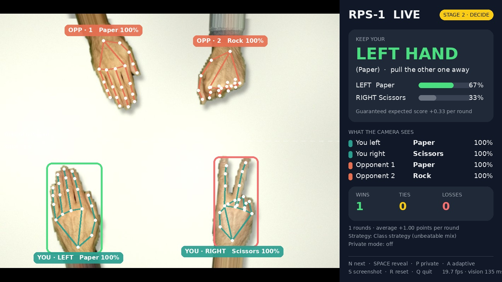
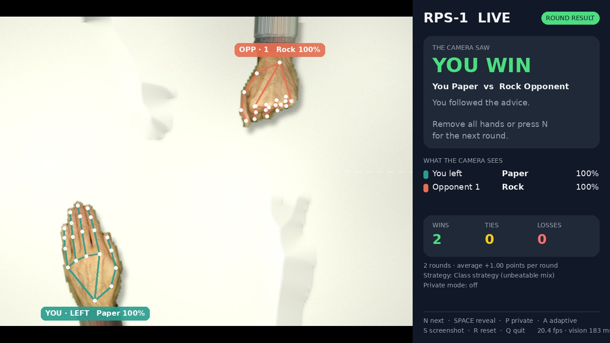

# RPS-1 Live: Setup Guide for the Team

`live_app.py` runs our project on a **live camera**. You see the video with every hand outlined and labelled, and a side panel that tells our player what to do, step by step:

1. Which pair to show.
2. Which hand to keep.
3. Who won the round, with a running score.



**It uses exactly the notebook's code.** The app loads the hand finder, the two classifiers, the game solvers and the opponent model straight from `RPS1_Project_Report.ipynb`, and trains on `images/train` the same way. So the live app always matches what the report describes and measures. If someone fixes the notebook, the app gets the fix too.

> **It must run on a laptop, not Colab.** Colab runs on Google's computers and can't see your webcam.

---

## Part 1 · What to download (everyone, once)

| What | Where | Notes |
|---|---|---|
| **Python 3.12** (64-bit) | python.org → Downloads | **Windows:** on the first install screen, tick **"Add python.exe to PATH"**. 3.11 also works. |
| **Git** | git-scm.com | Default options are fine. |
| **A webcam that can look down at the table** | — | See Part 3. A laptop's built-in camera faces you, not the table, so it works badly. |
| Optional: **VS Code** | code.visualstudio.com | Nicer for opening the notebook, but not needed. |

Everything else (MediaPipe, OpenCV, scikit-learn...) is installed by one command in Part 2. The hand model file is already in the repo, so nothing else needs downloading.

---

## Part 2 · Install and update (everyone)

### Windows (Command Prompt)

**First time:**
```cmd
cd %USERPROFILE%
git clone https://github.com/Kristina-Kojic/3350-AISE.git
cd 3350-AISE
py -3.12 -m venv .venv
.venv\Scripts\activate
pip install -r requirements.txt
```

**Every time after that** (gets everyone's latest changes):
```cmd
cd %USERPROFILE%\3350-AISE
git pull
.venv\Scripts\activate
pip install -r requirements.txt
```

### Mac (Terminal)
```bash
cd ~
git clone https://github.com/Kristina-Kojic/3350-AISE.git
cd 3350-AISE
python3.12 -m venv .venv
source .venv/bin/activate
pip install -r requirements.txt
```
On a Mac, the first time the app opens the camera, allow camera access for Terminal (System Settings → Privacy & Security → Camera).

### Check it works before touching a camera

This plays our demo photos as if they were a camera feed:
```cmd
python live_app.py --source images\demo
```
(On Mac use `images/demo`.) After 10–20 seconds of loading, a window opens showing the photos, the hands outlined and the decisions. Press **Q** to quit. **If this works, your install is good.**

`(.venv)` should appear at the start of the command line. If it doesn't, run the `activate` line again.

---

## Part 3 · Setting up the camera

The program decides whose hand is whose **by where it is in the picture**, so the camera position matters more than the camera itself.

```
              OPPONENT
         ┌───────────────────┐
         │   ✋        ✊     │   ← their hands come in from the TOP
         │                   │
         │      [camera]     │   ← camera above the middle, looking straight down
         │                   │
         │   ✋        ✌️     │   ← OUR hands come in from the BOTTOM
         └───────────────────┘
              OUR PLAYER
```

- **Camera:** above the middle of the table, pointing straight down, about 60–90 cm up, so all four hands fit with space around them. A USB webcam on a desk lamp arm, gooseneck clamp or small tripod works well. Taping it to a shelf edge works too.
- **Orientation:** our player must be at the **bottom** of the picture. If the picture comes out upside down, start the app with `--rotate` instead of moving the camera.
- **Light:** bright and even, from above. **Dim light is our biggest weakness**: in testing, the camera found only 75% of hands in dim light against 94–96% in good light. Turn the room lights on, and avoid a window behind the camera's view.
- **Table:** plain and uncluttered. A plain sheet of paper or card under the hands helps. Busy tables cost hands in testing (82% found).
- **Hands:** all four fully in view, not touching, sleeves pulled back. Fists are the hardest, so hold them still, knuckles towards the camera.
- **Using a phone as the webcam:** apps that turn a phone into a webcam (for example Phone Link on Windows, DroidCam or Iriun) make the phone show up as a camera. Prop the phone above the table and start the app with `--camera 1`.

---

## Part 4 · Running it

```cmd
python live_app.py
```

| Start option | What it does |
|---|---|
| `--camera 1` | Use the second camera, if the wrong one opens (try 2, 3...). |
| `--rotate` | Turn the picture 180°, if our player shows up at the top. |
| `--private` | Start in private mode (decision hidden until SPACE). |
| `--adaptive` | Start with our adaptive strategy instead of the class strategy. |
| `--source images\demo` | No camera: play photos from a folder (for testing). |

### What happens in a round

| Step | On the screen | What the players do |
|---|---|---|
| **1 · Show** | Big text: which two hands to show, e.g. **Rock + Paper**. The bar fills while all four hands are seen and steady. | Both players show two hands and hold still for about a second. |
| **2 · Decide** | **KEEP YOUR LEFT HAND** (or right). Green box around the hand to keep, red box around the one to pull away, plus the keep odds and guaranteed score. | Our player keeps the advised hand. Both pull one hand away. |
| **3 · Result** | **YOU WIN / TIE / YOU LOSE**, what each player kept, and whether we followed the advice. The score updates. | Remove all hands from the table. The next round starts by itself (or press **N**). |

The decision is **locked once**, when all four hands are steady. It then never flickers or changes while hands move. It is a random draw using the game-theory odds, so the same hands can give a different hand to keep next time. That's on purpose: it keeps us unpredictable.



### Keys

| Key | Action |
|---|---|
| **N** | Next round (skip ahead) |
| **SPACE** | Reveal the decision (private mode) |
| **P** | Private mode on/off |
| **A** | Adaptive strategy on/off |
| **S** | Save a screenshot to `captures/` (good for the report) |
| **R** | Reset the score and what we've learned about the opponent |
| **Q** or **Esc** | Quit |

### Private mode (for the competition)

In a real match the opponent must not see our decision before choosing. With **P** (or `--private`), the panel says **"Hidden"** and the green/red boxes are not drawn. Only our player looks, presses **SPACE**, and the decision appears.


### Adaptive mode

With **A**, the app learns which shapes this opponent tends to keep, from what the camera sees in each round's result. It leans our odds towards beating those habits. It stays within the safety limit from the notebook (Section 2.7), so it can never drop more than a small, fixed amount below the guaranteed score. Press **R** when you switch to a new opponent.

---

## Part 5 · Troubleshooting

| Problem | Fix |
|---|---|
| `'python' is not recognized` | Python isn't on PATH. Re-run the Python installer, choose **Modify**, and tick "Add Python to environment variables". Or use `py` instead of `python`. |
| `No module named cv2` / `mediapipe` | The virtual environment isn't active. Run `.venv\Scripts\activate`, then `pip install -r requirements.txt`. |
| "Could not open camera 0" | Close Zoom, Teams, Discord or the Camera app (only one program can use a camera). Or try `--camera 1`. |
| Window opens but the video is black | Try `--camera 1`. On a Mac, allow camera access for Terminal. |
| Our hands are labelled **OPP** and theirs **YOU** | The picture is upside down: restart with `--rotate`. |
| "Seeing 1/2 yours" and the bar never fills | A hand isn't being found. Add light, use a plain background, spread the hands out, keep them fully in the picture. |
| Shape label wrong or marked "low confidence" | Hold the pose clearly with fingers spread (Paper) or tight (Rock) and wait a moment. Low confidence means "check this hand yourself". |
| Takes 10–20 s to start | Normal: it trains the classifiers on our photos each time it starts. |
| Very slow (fewer than 5 fps) | Close other programs. The video stays smooth; only the hand labels update less often. |

---

## Part 6 · Who does what before the competition

1. **Everyone:** Parts 1–2, then run the `--source images\demo` test on your own laptop. Report any error in the group chat with a screenshot.
2. **One person (the camera rig):** build the camera mount (Part 3) and check that all four hands fit, our player is at the bottom, and the light is good.
3. **Everyone together:** play at least 20 practice rounds. Press **S** after any round the camera gets wrong, and write down why (light, fist, hands touching...). Those screenshots and reasons are exactly what the report's Discussion asks for.
4. **On the day:** start with `--private`, plug in the camera before starting the app, check the room's light, and play one practice round first.
