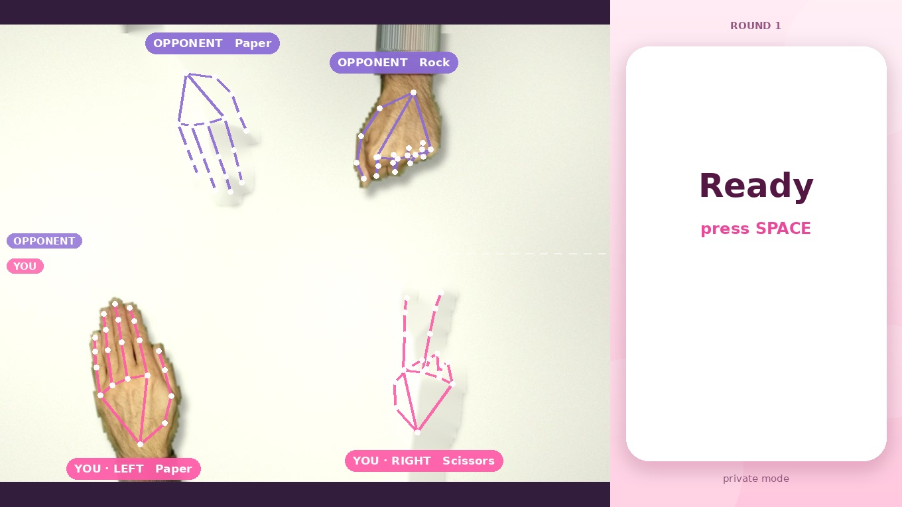

# RPS-1: Photograph and Live Webcam Demonstration Guide

The project provides two interactive demonstration modes:

- `photo_demo.py`: Processes the five official demonstration photographs as independent rounds.
- `webcam_demo.py`: Processes live camera frames and tracks actual game outcomes.

Both applications use the vision and game-theory algorithms from `RPS1_Project_Report.ipynb` through `live_app.py`.

The interface displays detected hand gestures, player ownership, recommended hand removal, left and right retention probabilities, and guaranteed expected payoff. Live webcam mode also tracks observed wins, ties and losses.

Mixed-strategy decisions are sampled according to the calculated retention probabilities. Static photographs do not produce actual game outcomes because the opponent's final retained hand is unknown.

---
## Part 1 · What to download (everyone, once)

| What | Where | Notes |
|---|---|---|
| Python 3.12 (64-bit) | python.org | On Windows, tick **Add python.exe to PATH**. |
| Git | git-scm.com | Default options are fine. |
| Webcam that can look down at the table | — | See Part 3. |
| Optional: VS Code | code.visualstudio.com | Useful for opening the notebook. |

The hand model is already in the repository. Other dependencies are installed in Part 2.

## Part 2 · Install and update (everyone)

### Windows (Command Prompt)

First time:
```cmd
cd %USERPROFILE%
git clone https://github.com/Kristina-Kojic/3350-AISE.git
cd 3350-AISE
py -3.12 -m venv .venv
.venv\Scripts\activate
pip install -r requirements.txt
```

For subsequent sessions, navigate to your existing clone (adjust the path if necessary):
```cmd
cd %USERPROFILE%\3350-AISE
git pull
.venv\Scripts\activate
pip install -r requirements.txt
```

### Mac (Terminal)
```bash
cd ~
git clone https://github.com/Kristina-Kojic/3350-AISE.git
cd 3350-AISE
python3.12 -m venv .venv
source .venv/bin/activate
pip install -r requirements.txt
```
Allow camera access for Terminal when prompted (System Settings → Privacy & Security → Camera).

### Check it works before touching a camera

This processes our five official demonstration photographs as independent rounds, without requiring a webcam:
```bash
python photo_demo.py
```
After loading, a window opens showing the photos, outlined hands and decisions.

| Key | Action |
|---|---|
| N | Advance to the next photograph |
| S | Resample the retention strategy |
| R | Restart from the first photograph |
| Q or Esc | Quit |

### Automated validation
```bash
python test_photos.py
```
This checks the five demonstration photographs for gesture recognition, player ownership, probability validity and payoff consistency. The expected final result is `5/5 passed`.

## Part 3 · Setting up the camera

The program decides whose hand is whose by where it is in the picture.

```
              OPPONENT
         ┌───────────────────┐
         │   ✋        ✊     │  Their hands enter from the top
         │                   │
         │      [camera]     │  Camera looks straight down
         │                   │
         │   ✋        ✌️     │  Our hands enter from the bottom
         └───────────────────┘
              OUR PLAYER
```

- **Camera:** above the middle of the table, pointing straight down, about 60–90 cm up, so all four hands fit with space around them. A USB webcam on a desk lamp arm, gooseneck clamp or small tripod works well.
- **Orientation:** our player must be at the bottom. If the picture is upside down, use `--rotate`.
- **Light:** bright and even, from above. In the reported testing, detection was 75% in dim light versus 94–96% in good light.
- **Table:** plain and uncluttered. A plain sheet of paper or card helps. Busy tables reduced detection to 82% in the reported testing.
- **Hands:** all four fully in view, not touching, sleeves pulled back. Hold fists still, knuckles towards the camera.
- **Phone webcam:** if your phone is configured as a webcam, prop it above the table and try `--camera 1`.

## Part 4 · Running the live webcam application

```bash
python webcam_demo.py
```

| Start option | What it does |
|---|---|
| `--camera 1` | Use the second camera (try 2, 3, etc.). |
| `--rotate` | Turn the picture 180°. |
| `--private` | Start in private mode (decision hidden until SPACE). |
| `--adaptive` | Start with the adaptive strategy. |

### What happens in a round

| Step | On the screen | What the players do |
|---|---|---|
| 1 · Show | Show your two hands; the progress bar fills as the four hands remain steady. | Both players show two hands and hold still. |
| 2 · Decide | TAKE AWAY your RIGHT or LEFT hand; a cross marks that hand. | Both players remove one hand. |
| 3 · Result | WIN, LOSE or TIE; the scoreboard updates. | Remove all hands for the next round, or press N. |

When the decision locks, the app remembers where the four hands were and whose each one was. After the take-away, the remaining hands are matched to the locked positions. The decision is sampled according to the game-theory probabilities and stays locked while the hands move.


### Webcam keys

| Key | Action |
|---|---|
| N | Next round |
| SPACE | Reveal the decision in private mode |
| P | Private mode on/off |
| A | Adaptive strategy on/off |
| S | Save a screenshot to `captures/` |
| R | Reset score and opponent learning |
| Q or Esc | Quit |

### Private mode (for the competition)

The opponent must not see our decision before choosing. Start with `python webcam_demo.py --private` or press P. Only our player should look when pressing SPACE to reveal the decision.



### Adaptive mode

With A, the app learns which shapes the opponent tends to keep from observed round results. It adjusts retention probabilities within the safety limit described in notebook Section 2.7. Press R when switching opponents.

## Part 5 · Troubleshooting

| Problem | Fix |
|---|---|
| Python is not recognized | Check Python installation and PATH. |
| No module named cv2 or mediapipe | Activate the virtual environment and run `pip install -r requirements.txt`. |
| Could not open camera 0 | Close other camera apps or try `--camera 1`. |
| Black video | Try another camera index; on Mac, allow camera access. |
| Player ownership reversed | Restart with `--rotate`. |
| Missing hands | Improve lighting, use a plain background, spread hands out and keep them in view. |
| Wrong gesture | Hold a clear pose and keep still. |
| Slow startup | The application trains classifiers when it starts. |
| Slow video | Close unnecessary programs. |

## Part 6 · Who does what before the competition

1. **Everyone:** Complete Parts 1–2, then run `python photo_demo.py` and `python test_photos.py` on your own laptop. Report any errors in the group chat with a screenshot.
2. **Camera rig:** Build the camera mount (Part 3) and check that all four hands fit, our player is at the bottom, and the light is good.
3. **Everyone together:** Play at least 20 practice rounds. Press S after any round the camera gets wrong and record the reason for the report's Discussion.
4. **On the day:** Start with `python webcam_demo.py --private`, plug in the camera before starting, check lighting and play one practice round first.
